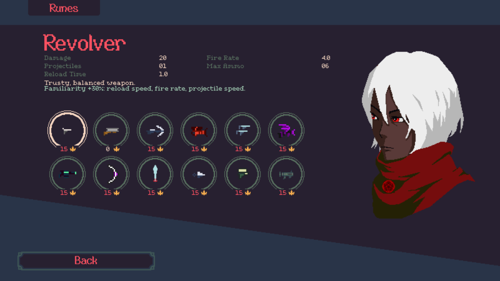
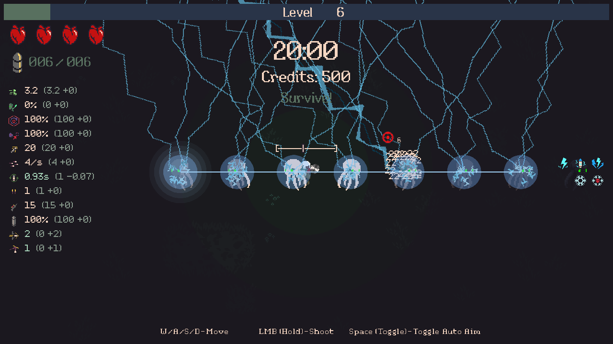
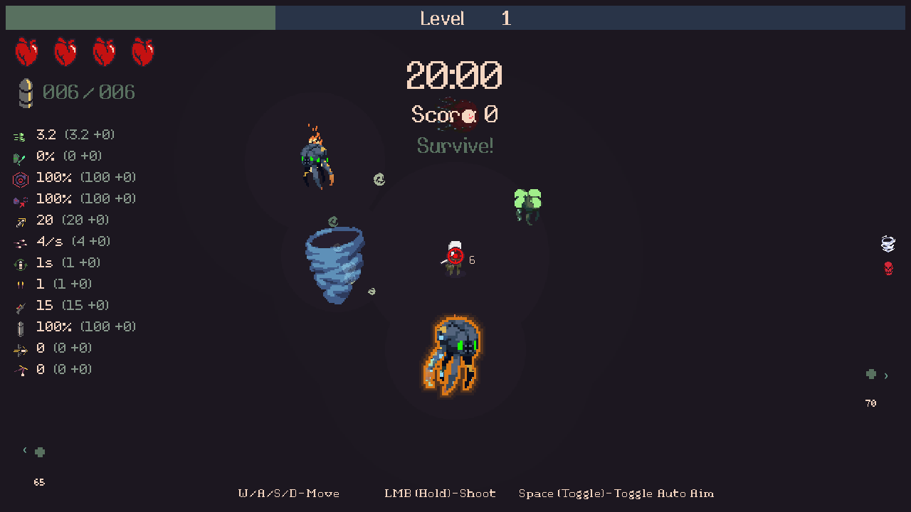
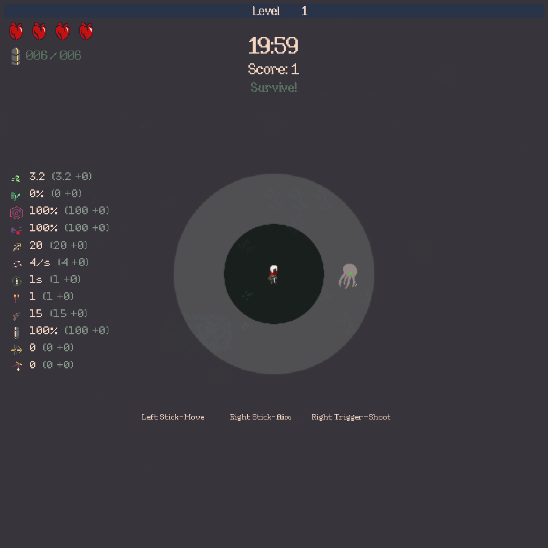
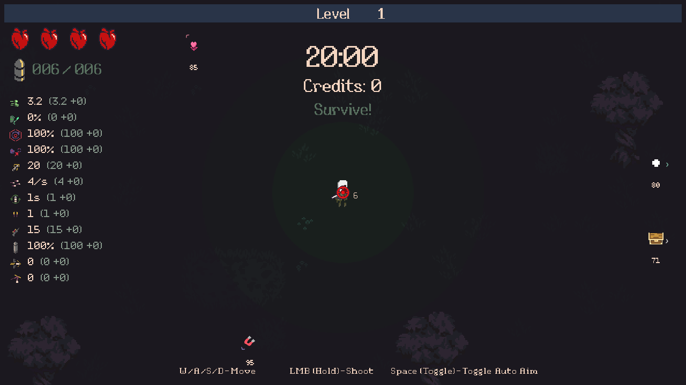
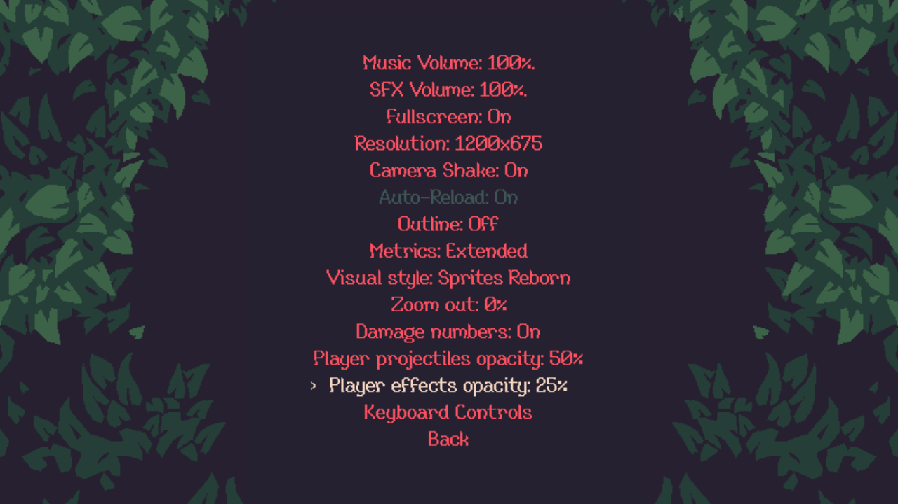
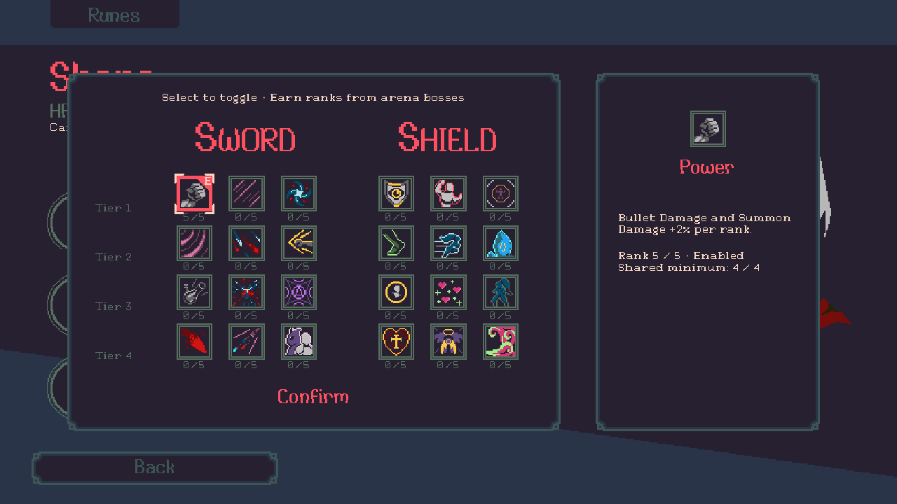
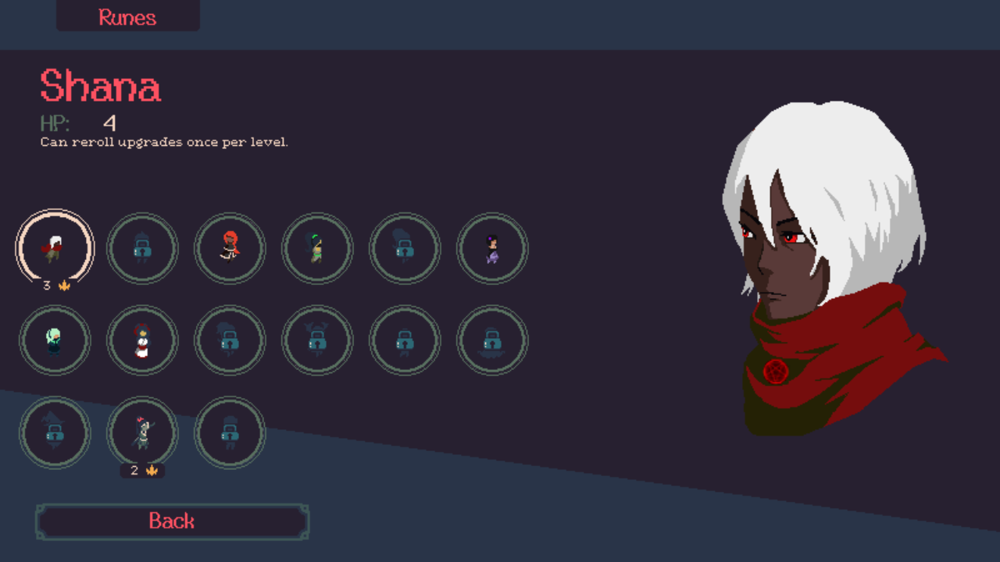
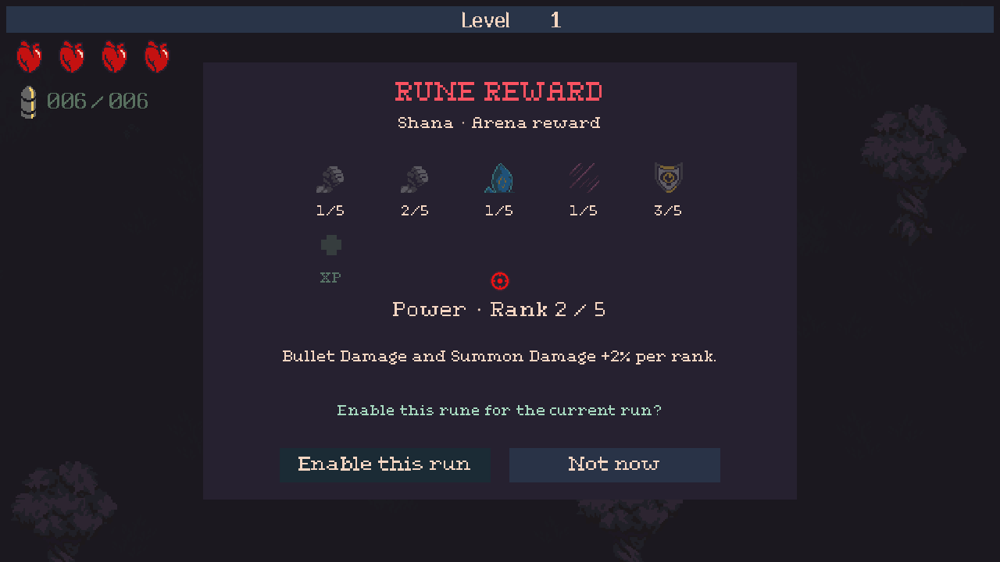
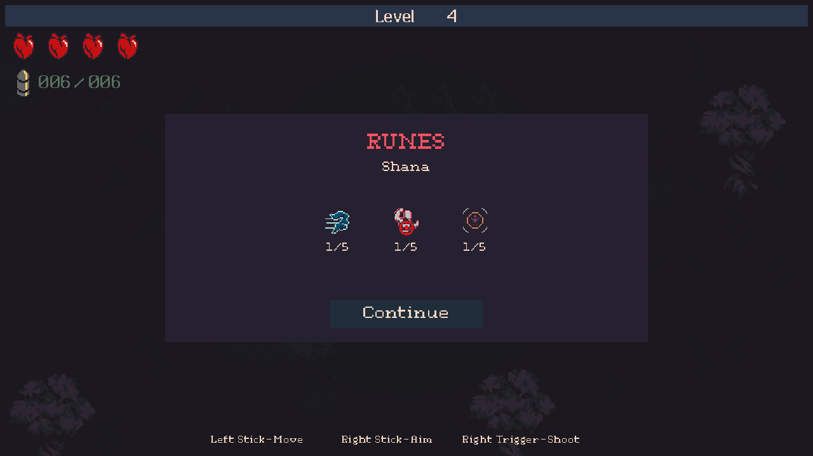

# 20 Minutes Till Dawn — Revamped

Android 8.6 gameplay brought to the Windows game, with a transparent stats HUD, milestone unlocks and a native Custom mode.

A community mod for **20 Minutes Till Dawn by Flanne**, maintained by **Darkaxt**.

[Download v1.3.10](https://github.com/Darkaxt/20-Minutes-Till-Dawn-Revamped/releases/tag/v1.3.10) · [Android updater 0.2.0](https://github.com/Darkaxt/20-Minutes-Till-Dawn-Revamped/releases/tag/updater-v0.2.0) · [Installation](INSTALL.md) · [Changelog](#changelog) · [Gameplay ledger](docs/PARITY.md)

## Executive summary

Revamped brings the audited Android 8.6 gameplay additions to the purchased Windows game, then improves progression, combat variety, build information and controller play. The work delivered so far includes:

| Area | Delivered improvements |
|---|---|
| **Specialize summons** | Shana’s triple-upgrade chest reward creates triple the actual summons: 3 eggs, mirrors, ghosts, scythes or Electro Bugs; 6 lances. |
| **Android gameplay integration** | Charge Cannon and its three evolutions; Gale and Bulwark with their exclusive upgrades; ported character abilities, upgrades, summons, status effects, enemy behavior, shooting, cooldowns, encounters and mode schedules. |
| **Progression through play** | Thirty milestone unlocks replace character/weapon/scenario purchases, with concise conditions, attempt details, notifications and difficulty-specific clear counters. Boss-awarded character runes replace rune purchases, with scenario/Darkness rewards, independent toggles, celebratory reveals, current-run activation choices and capped-rune XP. |
| **Less repetition between characters** | Mastering a rune raises that rune's shared minimum across the roster: one mastered character gives rank 1, then 2, 3 and 4. Higher personal progress is preserved; everyone earns their own fifth rank. Existing mastery counts, future characters inherit the head start, and enabled choices remain personal. |
| **Weapon familiarity** | Each weapon gains +2% reload speed, fire rate and projectile speed per highest crown level, up to +30%. Damage, spread and weapon counts stay unchanged. The existing record includes Challenge and is shared across characters. |
| **Distinct combat roles** | Lightning gains splash, stun and Pierce/Bounce-based chains; Energized scales reload speed with visible stunned enemies. Fire adds weakening propagation, brief local panic/slow and fireball explosions. Wind disrupts aiming and hostile bullets; ice retains its rules. Regular Elites and stronger Endless tiers add proportional health/XP, larger models, faster-firing Eyes and animated contour glows. |
| **Readable builds and rewards** | Transparent, vertically centered stats and grouped skill icons; Off/Little/Extended metrics; beneficial/detrimental colors; centered timer and Score; zoom-readable damage numbers with an explicit setting. Upgrade offers show their paths and build relations through skill, weapon and character icons, including benefits, penalties and mixed effects. |
| **Combat visibility** | Two independent native Options entries adjust player projectiles and other player effects to25/50/75/100%, default100. Summon/ability/explosion/trail/particle visuals fade separately from bullet bodies; enemies, hostile attacks, character and vision stay unchanged. |
| **Exploration and modes** | Continuous honeycomb POIs replace timed waves. Each cell balances basic rewards, utilities and one upgrade; only the three nearest uncollected targets appear on radar. Shared vertices and collected rewards persist through Continue. Challenge and native Custom menus retain their existing rules. |
| **Controls and continuity** | Controller navigation and focus across native menus, locked-content inspection, opaque Options, cleaner results and Retry. Save & return / Continue reconstructs supported runs, including legacy checkpoints. Zoom and display settings support different screen shapes while the HUD keeps its size. |
| **Presentation and reliability** | Selectable Sprites Reborn artwork with consistent projectile colors; corrected phoenix/facing visuals; sprite-masked fire, lightning and wind cues. Pixel-art maintenance credit and promotional-panel removal. Corrections cover damage signs, stacking, temporary buffs, shield/cooldown arithmetic, Shatter, collisions, pooled actors/effects and duplicate save/reward application. |
| **Windows and phone delivery** | Versioned Windows packages with owned-file install/rollback, plus DroidDeck support and an Android updater that locates the game, verifies GitHub releases and preserves compatible progress. The game remains the Windows mod running through DroidDeck. |

The gameplay reference is **Android 8.6 / versionCode 1093**. All identified required gameplay differences in the completed comparison are integrated. Ads, purchases and other monetization are excluded. Revamped's progression, HUD, Custom mode and desktop controls are intentional additions. [Exact parity scope and source quirks](docs/PARITY.md) · [Bug-correction contracts](docs/BUGFIXES.md).

*Actual Windows test capture. The maintenance credit is part of the pixel artwork; the Emberpath promotional panel is removed.*

*Release acceptance covers native weapon handling, controller/pointer preview, evolution, Retry, Custom and current/older Continue. Compatible saves are preserved. Exact-package/public-download evidence is recorded in [PROGRESS.md](docs/PROGRESS.md).*

## See it in game

### Grow familiar with a weapon

The existing weapon crown grants a small handling improvement, shared across characters. At crown5, the three handling stats gain10%; at crown15,30%. Repeating a clear does not stack bonuses, and each weapon keeps its own spread and counts. [Exact rules](docs/WEAPONS.md).

*Actual Windows controller test capture with a controlled crown15 record; live player progress is unchanged.*

### Elemental roles

Lightning gains a small stunning splash and Mastery chains scaled by Pierce + Bounce. Energized grants reload speed from visible electrocuted enemies. Fire spreads weaker burns, causes brief local circling and slow and gives Fire Starter an explosion. Wind gathers enemies, scatters hostile shots and disorients their aiming; ice keeps its existing rules. [Exact values and effects](docs/ELEMENTS.md).

*Controlled Windows fixtures show the actual new effects. Both artwork modes, native menus, mixed builds, current/older Continue and scenario transitions are verified; natural playtest balance remains for player feedback. Final exact-package and public-download acceptance is recorded in [PROGRESS.md](docs/PROGRESS.md).*

### Face enhanced regular enemies

Every **200 kills** earns an Elite opportunity: **3× health and XP**, **25% larger width/height**, a thin glowing **red sprite contour**, and **50% faster firing** for elite Eyes. The contour follows the animation; native facing retains the larger dimensions, including Forest exploders.

**Endless** adds Elite+ after every **10 defeated Elites**, and Elite++ after every **5 defeated Elite+** enemies. Each tier repeats the previous multipliers:

| Tier | Health / XP | Width / height | Eye firing frequency | Contour |
|---|---:|---:|---:|---|
| Elite |3×|1.25×|1.5×|Red|
| Elite+ |9×|1.5625×|2.25×|Amber|
| Elite++ |27×|1.953125×|3.375×|Violet|

Scheduled minibosses/bosses remain separate. Higher-tier claims preserve owed lower-tier promotions, and all counters survive Continue. Other modes retain ordinary Elites. [Full rules](docs/ELEMENTS.md#enhanced-regular-enemies).

*Controlled native Windows tests use actual elite defeats and XP collection, with the ordinary kill counter advanced to exercise tier boundaries. Both artwork modes, three viewport shapes, firing intervals, saved cadence and ordinary pool reuse are verified; these captures do not establish natural full-run balance.*

### Play the Android additions with desktop controls

Charge Cannon brings three weapon evolutions. Gale and Bulwark bring their character skills, animations and exclusive upgrades to the native Windows selection and combat flow.

*Unretouched capture using the published v1.3.5 game DLL. Only Bulwark ownership is granted for this isolated test; the current selector hides the obsolete currency badge and aligns Runes left.*

### Read your build without a panel

Attributes sit on the left in character → summons → weapons order. Acquired skills use **one icon-only row per upgrade path** on the right, with separate character, Tome and Synergy rows. Both groups center vertically, including on square screens. A tripled skill has a subtle glow instead of a count label.

The metrics omit Max HP and Magazine: the native hearts and ammo counter already show them at top left.

**F2** or native Options cycles **Off → Little → Extended** metrics. Little shows calculated values only; pastel green means improved and pastel red means worse, including shorter reload times in green. Extended also shows base and net bonus. Off hides metrics while keeping selected skills visible. Charge/conditional effects remain excluded from these base comparisons.

The original timer sits at top center below the level bar, with **Score** beneath it. It reads the game's current run calculation; the results screen shows **Total Score** for the completed run.

*Actual1280×720 Windows capture of the Score HUD with a controlled enemy-count fixture. Collected upgrade-path rows are verified separately; this is not a natural progression run.*

*Unretouched native 900×900 capture at100% zoom-out. Damage glyphs are50% smaller than before; zoom compensation, native animation and the On/Off setting remain intact.*

### See the upgrade path and its role in your build

The native selection panel shows the four-node upgrade path beside the description on the left. A dedicated right column separates **Benefits / Penalties**, with aligned miniature skill and weapon icons in native hexagons and the current character’s portrait when their special ability benefits. Summon interactions and newly completed Synergy recipes use the actual build. Compact enemy damage numbers stay readable while zooming out; **Options → Damage numbers** controls them explicitly and starts On. An edge icon points toward boss and exploration rewards, staying visible until the whole world chest is on screen and clear of the HUD.

When one target gains an attribute and loses another, it appears **once under Mixed (+ / −)**. For example, Double Shot adds a projectile but lowers bullet damage. This describes the trade-off without pretending to calculate a universal net benefit.

*Actual Windows controller selection capture. All25 regular native paths are checked; chart previews cannot select an unoffered upgrade. [Playtest fixes and projectile-color audit](docs/PLAYTEST-FIXES.md).*

*Controlled native offers and actual controller selection. Summon damage helps Ghost Friend and Lilith’s spirits; summon attack speed is only attributed to consumers that use it.*

### Explore for optional rewards

Uncollected chests **do not expire**. Normal fog reveal keeps them visible when their edge pointer hides. Within eight world units, a small glow reveals content: teal XP, rose healing, violet magnet, blue freeze, orange frenzy, lime upgrades and pink character upgrades. It fades with distance; boss presentation is unchanged.

Chest magnets send an attraction wave outward at **12 game units per combat second**, followed by each orb’s normal **0.3-second** flight. Equal-distance clusters are spaced across frames; nearby ordinary pickups can claim waiting orbs sooner. XP amounts are unchanged, and pause freezes the wave.

Exploration uses an invisible **honeycomb with 36-unit sides**. Each unobstructed cell contains XP, healing, magnet, freeze, frenzy and **one upgrade opportunity**; 10% of upgrade vertices instead offer a character upgrade. The arrangement varies per run. Shared corners belong to the same POI, and the radar shows only the **three nearest uncollected exploration targets**. Move from reward to reward without waiting for a timer.

Only the current cell's physical chests are loaded. Collected vertices stay collected, and discovered contents/positions survive Continue. Existing old chests are preserved on transition. XP still grants **30% of the current level requirement**; eligibility/full-health conversions and content icons stay intact. Boss treasure retains its separate chest pointer. Northern targets stay on the north edge while markers avoid each other along that edge.

XP indicators show a cluster of three rounded orbs shaded in the native XP tint, replacing the cross-shaped pickup symbol. Healing uses the native red-heart pickup, rather than the maximum-health upgrade; soul-heart artwork remains reserved for soul-heart rewards. At full red health, healing chests preview their XP replacement. An exhausted stored upgrade also switches its preview to XP without rerolling the chest.

*Earlier native content-icon fixture; the artwork and reward meanings remain current. The timed-wave placement and weights are superseded by the balanced honeycomb rules. [Current rules and acceptance](docs/POI-HONEYCOMB.md).*

### Finish a run with the controller

Victory and death show scores, the character/weapon loadout and **Try Again / Quit To Menu**, without the redundant skill list. Results navigation stays on those two buttons. Shown menus own controller focus, including recovery on the first controller input after switching from the mouse; no frame-by-frame focus override.

### Read controller focus at a glance

**Player projectiles opacity** and **Player effects opacity** are separate native Options entries, each25/50/75/100%. Both default to100%; the screenshot demonstrates50%/25%. They change visual tint only, preserving damage, hitboxes, character, vision, HUD and hostile attacks.

A small cream chevron follows the currently focused button, using the native menu font and scale. Text buttons show it just to the left; icon buttons keep it inside the left gutter. It follows existing selection without changing navigation or consuming input.

*Actual Windows controller capture. Title, pause, icon controls and scene changes are verified.*

### Track clears at the selected difficulty

Locked modes use the native padlock and a concise unlock condition. Applicable mode buttons show a crown and recorded clear count **inside the button**, for the selected Darkness or Challenge tier. Quickplay uses its fixed difficulty; Endless and Custom have no completion crown. Historical per-mode win totals were never stored, so these counters begin with1.1.7.

### Use the native Options menu with a controller

Metrics, visual style and **Zoom out** are native menu rows in title and pause Options. Zoom cycles0/25/50/75/100% extra world view without enlarging the HUD. Resolution remains usable in fullscreen; selecting a native16:9 resolution keeps that choice across re-entry/restart. The opaque background covers the previous menu and controller focus stays inside the panel.

*Actual1080p Windows controller test with integrated settings and no F2 suffix on the Metrics row. Fullscreen request semantics are tested without switching the desktop display. [Controller UI corrections and evidence](docs/CONTROLLER-UI.md).*

### Unlock content through play

Characters, weapons and scenarios use thematic milestones instead of currency purchases. Conditions combine minibosses or bosses with Darkness, scenario and build requirements. For example, Diamond requires a Forest miniboss defeat while holding at least seven maximum red hearts. Existing ownership is preserved; earned unlocks generate queued notifications.

Browsing shows a natural unlock sentence. Confirm/click a locked character or weapon to expand its recorded attempt details; moving to another entry or reopening the roster returns to the concise preview. Inspection preserves ownership and credits.

### Earn character runes from arena bosses

Runes are earned automatically from arena bosses. Credits, hold-to-buy and column purchase prerequisites are removed. Press an earned rune to enable or disable it; multiple runes in the same row can remain active. The five-rank cap remains, and existing Windows purchased ranks seed each character once.

**Mastery gives the other characters a head start.** Each distinct character reaching rank5 raises that rune's shared minimum by one, capped at 4. The remaining characters inherit rank1,2,3,then4; existing higher ranks stay intact. This is a minimum, not an added rank: another character at rank4 stays at4. Every character earns its own fifth rank through the boss lottery. Existing mastery counts retroactively and characters first played later inherit the same minimum. Enabled selections stay personal, and an ongoing battle keeps its established rune effects.

*Actual Windows controller capture with controlled prior progress and real boss grants. All24 descriptions, square/4:3/16:9, both artwork styles, capped XP, current/older Continue, pre-boss replay and Retry are verified. [Shared-rune contract](docs/RUNES.md#shared-rune-head-start--2026-10-29).*

Character and weapon selection omit the obsolete currency badge. The Runes tab sits at the left edge of the header, with its native background, prompt and show/hide animation.

Forest's total lottery draws rise from **1 → 3 → 6 → 10** at Darkness **0 / 4 / 8 / 12**. Temple uses Darkness+4; Pumpkin Patch uses +2. The first arena boss awards half, rounded down; the second receives the remainder. Quickplay's single arena boss receives the full allotment. Endless awards again for each boss pair; Challenge awards once, and Custom is excluded. [Exact row table and interactions](docs/RUNES.md).

Each slot rolls for four seconds, slows and celebrates its saved result with native chest sounds. The selected rune's name, rank and effect description remain available with controller or pointer. Once all slots are revealed, capped runes burn into XP gems inside the popup: a discarded tier-1 rune is half a level, tier-2 is one level, and so on.

A newly awarded effect offers **Enable this run / Not now**. Accept applies its final awarded rank once; decline preserves the current build. Already active runes keep their battle-start rank. Permanent ranks improve future runs, and Continue preserves outcomes, activation decisions and compensation without rerolls.

Enabled character runes also work at the start of **Endless**; Revamped removes the shipped mode's starting-rune restriction.

### Build a Custom run

Use the game's own menus to adjust the run, weapon, attributes, enemies, summons, upgrades and objects. **Load mode defaults** imports the selected mode's real settings. Only obtained content is available. Custom runs award **score only**: no unlocks, achievements or leaderboard submissions.

[Full Custom control inventory and save behavior](docs/CUSTOM.md).

## Install or upgrade

You need your own **Windows Steam build 12679152** (Unity 2019.4.40f1 Mono x64) and the supported **Android 8.6 / 1093 APKM**. Python 3.14 x64 and .NET 10 are the tested preparation prerequisites.

1. Download and extract the [v1.3.10 release ZIP](https://github.com/Darkaxt/20-Minutes-Till-Dawn-Revamped/releases/tag/v1.3.10).
2. Close the game and follow [INSTALL.md](INSTALL.md), including its upgrade instructions if Revamped is already installed.
3. Launch the game normally through Steam.

The release contains the mod and installer recipes. It prepares the required artwork/data locally from your owned inputs; extracted game assets and validation assemblies are not bundled. Windows installation preserves the original game files, saves and configuration and supports exact owned-file rollback.

**DroidDeck:** updater 0.2.0 finds the existing Steam game and performs the one-time rune-transition save reset described below. Later updates preserve new progress and settings. This runs the Windows mod inside DroidDeck. [Phone delivery and launch notes](docs/DROIDDECK.md).

### Update directly on Android

**Use updater 0.2.0.** Updating1.3.0–1.3.6 to1.3.7 preserves progress and Continue. Updating from before the character-rune transition resets this game's old progress once, as shown by **Reset saves & install**. Settings and other games remain. Use the DroidDeck/Steam-library folder grant; the updater locates the selected game's own save prefix.

Install **Revamped Updater**, connect DroidDeck once through Android Files, then check and install compatible GitHub releases. It finds the game through Steam's library catalogue and remembers the folder; no custom folder, Linux browsing, root, Shizuku or GitHub login is needed.

*Actual native Android view capture. The updater verified the real GitHub package and upgraded the tested phone from1.1.2 to1.1.3. Existing artwork and loader files must already match the release; incompatible changes report that Windows preparation is required before writing. [Updater instructions and limits](android-updater/README.md).*

## Controls

| Action | Control / location |
|---|---|
| Move, aim, shoot and character skill | Native keyboard/mouse/controller bindings |
| Toggle auto-targeting | Space; native controller equivalent |
| Off / Little / Extended metrics | F2 or Options; skills stay visible |
| Widen the world view | Options → Zoom out |
| Show or hide damage numbers | Options → Damage numbers |
| Collected skill paths | Automatic rows; all acquired icons stay visible |
| Suspend a run | Pause → Save & return; Continue resumes it |
| Configure a Custom run | Custom selection; live settings from Pause |
| Optional recolours | Options; original artwork is the default |

The HUD groups acquired icons by native upgrade path, with a subtle glow for tripled skills and no tier/count text. Native auto-targeting remains available; no separate autofire toggle was added. Continue reconstructs the supported build and runtime state; it is not a frozen snapshot of every live enemy, projectile or RNG state.

## Changelog

### v1.3.10 — Honeycomb exploration and menu focus

**Added:** continuous, balanced honeycomb POIs with three-nearest radar and persistent shared vertices. **Fixed:** north-facing indicators jumping to side edges; unclear menu selection now has a native-style chevron. Old checkpoints retain their unopened rewards without a reset. **Added:** separate player-projectile and player-effects opacity controls in native Options. [Release notes](release/NOTES-1.3.10.md) · [Rules and verification](docs/POI-HONEYCOMB.md).

### v1.3.9 — Specialize summon correction

**Fixed:** Shana’s next-upgrade multiplier now creates 3 dragon eggs, mirrors, ghosts, scythes and Electro Bugs, or 6 lances. Its extra applications use pristine definitions, preserving stat scaling without an additional summon-damage multiplier. No save reset. [Release notes](release/NOTES-1.3.9.md) · [Evidence and scope](docs/SPECIALIZE.md).

### v1.3.8 — Weapon familiarity

**Added:** +2% reload speed, fire rate and projectile speed per highest weapon crown level. Spread, damage and integer counts stay unchanged. Native descriptions/HUD show the bonus; Continue preserves the starting rank. No save reset. [Release notes](release/NOTES-1.3.8.md) · [Rules and verification](docs/WEAPONS.md).

### v1.3.7 — Compact damage numbers

**Improved:** damage glyphs are50% smaller at every zoom level while retaining zoom compensation. Native animation, damage, pooling and the existing On/Off setting remain unchanged. No save reset. [Release notes](release/NOTES-1.3.7.md) · [Verification](docs/VISUALS.md#compact-damage-numbers--2026-10-30).

### v1.3.6 — Local fire panic and paced XP

**Fixed:** burning enemies loop locally and retain their pursuit direction instead of running away with stale momentum. **Improved:** chest magnets attract XP in a distance-based wave, pacing dense groups across frames; ordinary pickup and XP amounts remain unchanged. XP rewards now show a three-orb cluster. No save reset. [Release notes](release/NOTES-1.3.6.md) · [Contracts and verification](docs/ELEMENTS.md#local-fire-panic--2026-10-29).

### v1.3.5 — Shared rune head starts

**Added:** mastering a rune raises its minimum rank across the other characters, capped at 4. Existing higher progress and enabled choices stay intact; each character earns its own fifth rank. Existing mastery and future characters are supported without another save reset. **Updated:** an executive summary of all delivered improvements now opens the README. [Release notes](release/NOTES-1.3.5.md) · [Rune contracts and verification](docs/RUNES.md#shared-rune-head-start--2026-10-29).

### v1.3.4 — Visible combat and sprite status effects

**Fixed:** permanent automatic damage-number hiding; Options now provides an explicit controller-accessible On/Off choice, enabled by default. **Improved:** animated sprite-masked fire, electrical and disorientation overlays replace the status disks, and fire remains visible for its full burn lifetime. **Fixed:** chest content pointers remain until the whole world chest is on screen and clear of the HUD. Exploration chests do not expire. No balance or save-format changes; updater0.2.0 remains compatible. [Release notes](release/NOTES-1.3.4.md) · [Verification](docs/VISUALS.md).

### v1.3.3 — Rune celebrations and readable rewards

**Improved:** longer rune roulette, native fanfare, browsable descriptions and explicit current-run activation choices. **Changed:** starting character runes work in Endless. **Fixed:** native XP/heart reward icons and truthful replacement previews. **Updated:** Score throughout the UI and Total Score on results. No additional Android port; updater0.2.0/epoch1 and existing saves remain compatible. [Release notes](release/NOTES-1.3.3.md) · [Verification](docs/PROGRESS.md).

### v1.3.2 — Clean selection header

**Fixed:** the obsolete currency badge left behind on character/weapon selection. **Improved:** the complete Runes tab now aligns to the left and retains its native animation, artwork/prompt and controller/mouse hit area. Credits and character rune progress remain unchanged. **Ported:** no additional Android behavior. Updater0.2.0/save-epoch1 remains compatible. [Release notes](release/NOTES-1.3.2.md) · [Verification](docs/PROGRESS.md).

### v1.3.1 — Animated elite contours, Endless tiers and exploration contents

**Added:** Elite+ and Elite++ in Endless, with repeated health/XP/size/Eye-speed ratios, amber/violet contours and saved defeat/claim counters. **Fixed:** native facing resetting enlarged Forest exploders; animated outlines replace the elite circle. **Changed:** exploration chests award no credits and show actual content icons at the screen edge; old unopened credit drops become XP while already earned totals remain. **Ported:** no additional Android behavior; these are requested Revamped playtest changes. Updater0.2.0 remains compatible and the save epoch stays1, without another reset after the rune transition. [Release notes](release/NOTES-1.3.1.md) · [Verification](docs/PROGRESS.md).

### v1.3.0 — Character runes and arena-boss rewards

**Added:** permanent character-specific rune ranks, automatic row-based boss lotteries, sequential slot reveals and capped-rune burning/XP conversion in one popup. Standard splits rewards between its two arena bosses; Quickplay's sole boss receives all; Endless repeats per pair; Challenge awards once; Custom is excluded. **Changed:** rune purchases/prices/column prerequisites are removed, while independent toggles and the five-rank cap remain. **Fixed/refined:** legacy rank migration and battle-copy/Continue ownership; Wild Magic Curse/Smite chains, Elemental Barrage's new control consumers and Dedication's offensive-family counting. [Exact rules](docs/RUNES.md) · [Release notes](release/NOTES-1.3.0.md).

### Android updater 0.2.0

**Added:** a visible one-time save reset for the rune transition, scoped to this game's Steam prefix, with interrupted-reset recovery and an installed epoch that preserves new progress on later/repeated updates. Existing signer and folder autodetection remain. Game 1.3.0 requires this updater. [Instructions](android-updater/README.md).

### v1.2.1 — Larger elite enemies

**Added:** elite regular enemies are 25% larger in width and height, including their collision bounds. Pool return restores the exact original size, without growth accumulating on reuse. The red aura, 3× health/XP and faster Eye firing remain. Only wind knockback scales with damage/maxHP; the other control durations remain fixed. [Release notes](release/NOTES-1.2.1.md) · [Exact rules](docs/ELEMENTS.md).

### v1.2.0 — Elemental roles and elite enemies

**Added/refined:** lightning splash/stun/chains, visible-stun Energized reload speed, fire panic/spread/explosions, defensive wind and distinct visual cues; kill-earned elite regular enemies with3× health/XP and faster Eyes. **Fixed:** duplicate lightning collision damage, stale pooled burns and non-pooled fireball primary impacts. Ice is unchanged. Current/older Continue and native controller/mode behavior remain supported. [Release notes](release/NOTES-1.2.0.md) · [Exact rules](docs/ELEMENTS.md).

### v1.1.11 — Visible exploration rewards and restored vision

**Fixed:** exploration chests hidden by shadows after their edge pointer disappeared, and the zero-sized player reveal after Continue. **Added:** nearby reward colors using a small native-art glow; distant pointers remain mint. Unclaimed chests do not expire and retain exact rewards/positions through Continue. Existing rewards, balance and boss chests are preserved. [Release notes](release/NOTES-1.1.11.md) · [Color legend](docs/EXPLORATION.md#nearby-content-colors).

### v1.1.10 — Phoenix facing

**Fixed:** Scarlett’s phoenix and other projectiles publish their visible angle immediately, including pooled reuse, instead of waiting for a physics update. **Checked:** all 37 loaded projectile templates in eight directions/two activations, independent spirit/icicle facing, both artwork modes, actual phoenix/Fire Starter contacts and Yuki animation after scene restart. Authored particles, artwork and combat recipes are preserved. [Release notes](release/NOTES-1.1.10.md).

### v1.1.9 — Results focus and useful exploration rewards

**Fixed:** results controller navigation/focus and duplicated benefit/penalty icons; mixed trade-offs now show once. **Improved:** removed the end-of-run skill list; exploration travel varies across5–30 seconds; credit chests give1,000 credits and XP scales with30% of the current level requirement, including native bonuses. Existing positions and collected totals survive Continue. **Ported:** no additional Android behavior; these are requested Revamped playtest corrections. [Release notes](release/NOTES-1.1.9.md) · [Reward rules](docs/EXPLORATION.md).

### v1.1.8 — Exploration chests and shared pointers

**Added:** weighted benign exploration rewards, simultaneous common chests in different directions, a three-chest cap and20–30-second walking targets on open maps. Native upgrade menus and credit payout, exact reward/timer/position persistence and Custom ownership rules are retained. **Fixed:** complete edge-marker bounds, same-direction separation and collected boss-pointer cleanup. **Ported:** no new Android behavior; exploration is a requested Revamped addition. [Release notes](release/NOTES-1.1.8.md) · [Reward rules](docs/EXPLORATION.md).

### v1.1.7 — Stillness correction and compact native menus

**Fixed:** Stillness blocks movement only while shooting; releasing fire and reloading restore movement, including existing checkpoints. Its bonuses are retained. **Improved:** twelve metric rows without duplicate hearts/magazine; hexagon-framed Benefits/Penalties icons and character portraits; native campaign padlocks, concise descriptions and no shortcut suffix on the Metrics setting. **Added:** recorded clear-count crowns inside applicable mode buttons, separated by selected Darkness/Challenge tier. Historical totals are not invented. [Release notes](release/NOTES-1.1.7.md) · [Contracts and evidence](docs/PLAYTEST-FIXES.md).

### v1.1.6 — Playtest fixes and cleaner build HUD

**Added:** acquired-path HUD rows, current-build summon/Synergy help and off-screen chest directions. **Fixed:** hidden native upgrade charts, zoomed damage-number readability, square-screen HUD placement, reload benefit colors and neutral Shotgun/fireball rendering in Sprites Reborn. **Improved:** icon-only skills with triple-acquisition glow and benefit-first Glass/Stillness descriptions, preserving their actual gameplay trade-offs. [Release notes](release/NOTES-1.1.6.md) · [Contracts and color audit](docs/PLAYTEST-FIXES.md).

### v1.1.5 — Display, readable unlocks and Isaac-style HUD

**Added:** persistent native Zoom out; Off/Little/Extended metrics with pastel value comparisons; centered timer and current-run credits. **Fixed:** fullscreen Resolution selection/persistence and skill-column clipping at4:3. **Improved:** character/summon/weapon metric ordering, natural unlock sentences and attempt details on locked-entry activation. Native skills/counts/tiers, Continue, controller/pointer navigation and Challenge spacing are preserved. [Release notes](release/NOTES-1.1.5.md).

### v1.1.4 — Controller menus and native Options

**Fixed:** controller access to Challenge/Custom and their native tier/Play/Back flow; Custom numeric-field focus traps; B/Cancel on failed Continue. **Improved:** stats HUD and visual style are native Options rows in title and pause, with an opaque background and navigation confined to the panel. Pointer input, settings persistence, existing locks, credits and saved checkpoints are preserved.

Verified with Unity controller/pointer events at720p/1080p, all Custom tabs/pages, rune traversal, roster regression and fresh-process settings. [Release notes](release/NOTES-1.1.4.md) · [Controller ledger](docs/CONTROLLER-UI.md).

### Android updater 0.1.0

**Added:** automatic DroidDeck Steam-library detection after one folder grant, remembered installation, public GitHub release notes/download verification, compatible code deployment, installed-file read-back and interrupted-update recovery. Native Android UI follows the selected utility layout with Revamped colors. This is a separate APK; the game was1.1.3 when this client was released.

### v1.1.3 — Controller roster fixes

- Character name, portrait, HP and description initialize immediately on controller entry, including remembered selections and re-entry.
- Charge Cannon is reachable at the end of the second weapon row. Gale and Bulwark also have complete native controller links.
- Locked content remains previewable without being playable or spending credits. Valid remembered added characters are restored after the original roster initializes.

Verified with actual controller and mouse input in the isolated Windows player at 1280×720 and 1920×1080. Saves, ownership and gameplay balance are unchanged. [Release notes](release/NOTES-1.1.3.md).

### v1.1.2 — Android integration closure

**Ported:** complete Abby spray/final-shot and base/charged shooter flow; global Spark/Dragon Bond observers and target selection; source reload activation/audio, hit/burn/pickup filters, 0.03-second physics cadence and gameplay transition ownership. The retained-code and acquisition comparison is closed, with explicit dispositions for source quirks.

**Fixed:** Glass is rebuilt from acquisitions at run boundaries, preventing repeated warm Continue from multiplying its bonus. Working Hina, Holy Shield and Gun Glyph contacts are retained under the approved collision-defect corrections.

[Release notes](release/NOTES-1.1.2.md) · [Detailed parity ledger](docs/PARITY.md).

### v1.1.1 — Character, enemy and description fixes

**Fixed:** Hina's first detached Shadow Clone keeps its skill-origin position; Rhogog's reused explosion rearms its existing damage child; destroyed Thousand Blades helpers unsubscribe. Thunderspawns, Soul Knight, Cadence, Tenacity and Reckless descriptions now match their mechanics.

### v1.1.0 — Remaining ports and the anomaly correction batch

**Ported:** complete Crossbow-family auto-release, laser arming/rearming, Yog/Reaper spawn cues, source camera following and Blessing cooldown ownership.

**Fixed:** Smite kill reporting; frozen-only Shatter; Elemental Barrage contributions; Might and positional-lightning damage signs; exact pool caps and renderer reuse; finite reward-offer exhaustion; Specialize lifetime; Bulwark/Gale run resets; arena-edge reuse; late Darkness damage; Pulsing Summons configuration; temporary-buff and legacy Continue reconstruction; Growth reward duplication; LargeXP renderer binding; burn reuse/invalid targets; Fire Edge teardown; Soul Powered contribution leaks; and Hidden Blade knockback contacts. The reviewed ownership-inversion branch has no Windows equivalent to repair.

### Initial Revamped additions retained in v1.1.2

**Added:** transparent Isaac-inspired icon HUD; thirty milestone unlocks and persistent notifications; same-column rune progression, 20% rank pricing and multiple enabled row choices; Save & return / Continue; native Custom menus, owned-content limits, credits-only results and mode-default loading; reversible Sprites Reborn recolours with palette extensions; pixel-art maintenance credit; removal of the Emberpath promotion.

**Ported:** Charge Cannon and all three evolutions; Gale and Bulwark with their exclusive upgrades; existing character, summon, projectile/status, stat, perk/rune and scenario/mode behavior from Android 8.6. Later releases above complete and correct this integration rather than redefining its scope.

[Full anomaly history](docs/ANOMALIES.md) · [Correction-by-correction evidence](docs/BUGFIXES.md) · [Release and verification history](docs/PROGRESS.md).

## Verification and limits

The published **1.3.4** package verifies real damage numbers and their explicit native setting, current/public1.3.3 Continue, unobscured whole-chest marker handoff/contact, actual GPU-masked fire/lightning/wind effects, native Freeze/mixed effects, elite/pool lifecycle, reward icons and complete controller menus. Both artwork modes, square/4:3/16:9 and zoom0/100 pass. Copied install/rollback and the independently downloaded public source/package hashes verify. Updater0.2.0/save-epoch1 remains compatible without another reset. [Final delivery evidence](docs/PROGRESS.md).

The earlier **1.3.3** package verified native reward icons and truthful replacement previews, longer rune fanfare/descriptions, actual accepted and declined current-run effects, starting runes in Endless, current/public1.3.1 Continue and Score/results. That retained verification remains applicable to unchanged gameplay.

The published **1.2.1** package passes the elite-size native workflows, both artwork modes, exact pool restoration, current/prior Continue and source modes/Custom. Copied installation/rollback and independent public-download verification are recorded in [PROGRESS.md](docs/PROGRESS.md).

The published **1.2.0** package passes the complete elemental/elite native workflows, both visual styles, current/prior Continue, all modes/Custom, controller menus and exploration regression. Exact packaged runtime, copied installation/rollback and independent public-download verification are recorded in [PROGRESS.md](docs/PROGRESS.md). The previous published **1.1.11** package passes POI visibility, all eight nearby reward colors and fresh-process Continue vision with acquired vision bonuses. Exact packaged native workflows, copied installation/rollback and independent public-download verification are recorded in [PROGRESS.md](docs/PROGRESS.md). The previous published **1.1.10** package passes the native directional-effects audit in both artwork modes, actual phoenix/Fire Starter/Shotgun behavior and Yuki animation/restart. Copied installation/rollback and independent public-download verification are recorded in [PROGRESS.md](docs/PROGRESS.md). The previous published **1.1.9** package passes native results navigation, Retry/death/Quit, complete retained menus, Mixed relations, varied exploration placement, scaled XP/credits, current/older Continue and native payout. Copied installation/rollback and the independently downloaded public package are verified in [PROGRESS.md](docs/PROGRESS.md). The unchanged gameplay integration retains its recorded acquisition, fire/reload, contact, lifecycle, restart, legacy and Custom checks. The Android updater previously completed a real1.1.2→1.1.3 update; current compatible releases remain user-deployed. [Controller verification](docs/CONTROLLER-UI.md).

These are bounded source and gameplay checks, not a natural full-run balance study or a test of every character × weapon × upgrade combination. The next step is user playtesting before broader promotion. [Exact delivery receipt](docs/PROGRESS.md).

The gameplay images above are unaltered Windows test screenshots, including earlier UI runs whose behavior remains in the release. They show test builds rather than claiming natural unlocks or full-run balance. The updater image is explicitly labelled as a native Android capture. [Screenshot provenance](docs/images/SOURCES.md).

## Development and credits

This is an independent mod repository; the proprietary game has no public source repository to fork. Game binaries, extracted artwork, saves and raw disassembly are not published here. [Development and migration notes](docs/MIGRATION.md) · [Redirected-code audit](docs/DEAD-CODE.md).

For an already prepared development player, set `MODERNIZATION_SCRATCH` to a root containing `game/MinutesTillDawn_Data/Managed` and `game/BepInEx/core`. Build the production project or the separate `validation/Validation.csproj` with the documented SDK; keep the validation assembly out of a normal installation. [Build instructions](INSTALL.md#build-from-source).

**Flanne** created the original game. **Darkaxt** maintains Revamped. Original repository code is MIT licensed; game assets and dependencies retain their owners' rights and licenses. Third-party mod binaries are not bundled. [Third-party notices and artwork credits](docs/THIRD-PARTY.md).
