# 20 Minutes Till Dawn — Revamped

Android 8.6 gameplay brought to the Windows game, with a transparent stats HUD, milestone unlocks and a native Custom mode.

A community mod for **20 Minutes Till Dawn by Flanne**, maintained by **Darkaxt**.

[Download v1.1.10](https://github.com/Darkaxt/20-Minutes-Till-Dawn-Revamped/releases/tag/v1.1.10) · [Android updater](https://github.com/Darkaxt/20-Minutes-Till-Dawn-Revamped/releases/tag/updater-v0.1.0) · [Installation](INSTALL.md) · [Changelog](#changelog) · [Gameplay ledger](docs/PARITY.md)

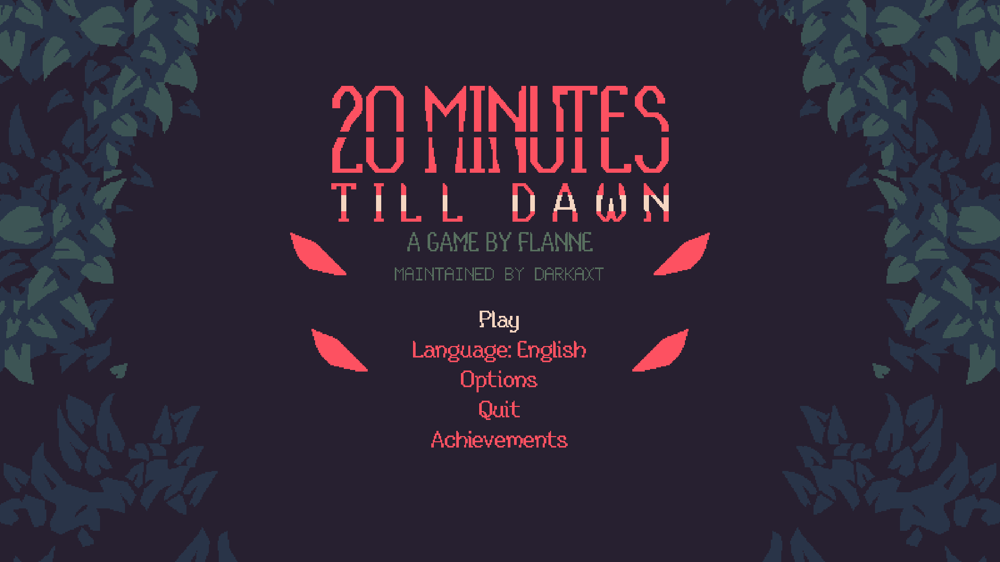

*Actual Windows test capture. The maintenance credit is part of the pixel artwork; the Emberpath promotional panel is removed.*

## What changes

- **Added for Revamped:** transparent stats and skill HUD; thirty milestone unlocks and notifications; expanded rune progression; Save & return / Continue; native Custom settings and mode-default loading; weighted exploration chests and shared edge pointers; optional artwork recolours.
- **Ported from Android 8.6:** Charge Cannon and its three evolutions; Gale and Bulwark with their exclusive upgrades; existing character abilities, combat, status effects, summons, stacking, cooldowns, shooting, event ordering, scenario schedules and mode behavior.
- **Fixed after the anomaly review:** repeated Continue bonuses, damage signs, frozen-only Shatter, temporary-buff accounting, pooled-effect reuse, exhausted reward menus, encounter/contact defects, character/summon lifetimes and inaccurate descriptions. The changelog below separates each release's ports and corrections.

The gameplay reference is **Android 8.6 / versionCode 1093**. All identified required gameplay differences in the completed comparison are integrated. Ads, purchases and other monetization are excluded. Revamped's progression, HUD, Custom mode and desktop controls are intentional additions. [Exact parity scope and source quirks](docs/PARITY.md) · [Bug-correction contracts](docs/BUGFIXES.md).

## See it in game

### Play the Android additions with desktop controls

Charge Cannon brings three weapon evolutions. Gale and Bulwark bring their character skills, animations and exclusive upgrades to the native Windows selection and combat flow.

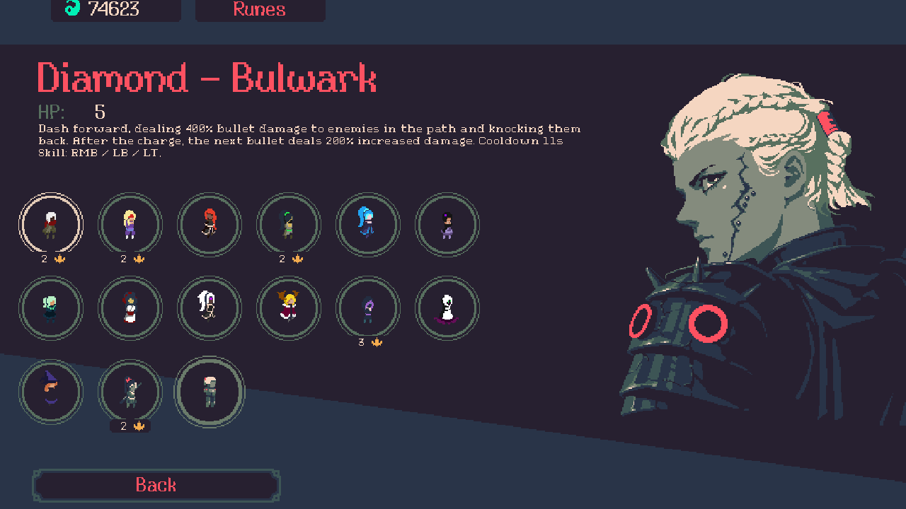

*Windows selection test using an unlocked test profile. The displayed Bulwark description and starting HP match the prepared v1.1.2 character data.*

### Read your build without a panel

Attributes sit on the left in character → summons → weapons order. Acquired skills use **one icon-only row per upgrade path** on the right, with separate character, Tome and Synergy rows. Both groups center vertically, including on square screens. A tripled skill has a subtle glow instead of a count label.

The metrics omit Max HP and Magazine: the native hearts and ammo counter already show them at top left.

**F2** or native Options cycles **Off → Little → Extended** metrics. Little shows calculated values only; pastel green means improved and pastel red means worse, including shorter reload times in green. Extended also shows base and net bonus. Off hides metrics while keeping selected skills visible. Charge/conditional effects remain excluded from these base comparisons.

The original timer sits at top center below the level bar, with credits earned this run beneath it. Credits use the game's current reward calculation and do not change the wallet.

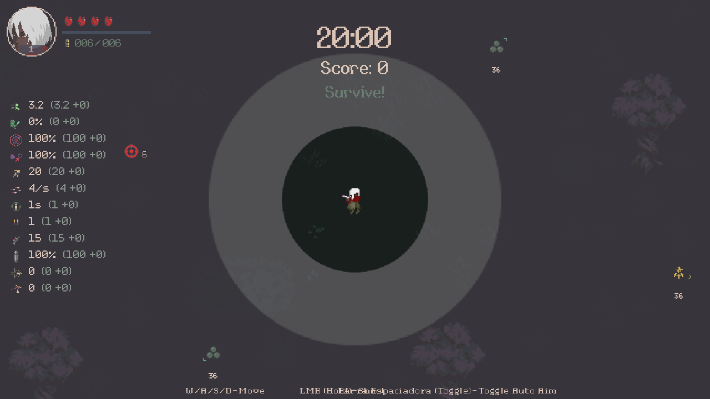

*Actual1280×720 Windows capture with twelve metric rows and controlled Lilith/Ghost Friend/stat upgrades. Also verified at900×900,1024×768 and through Continue; not a natural progression run.*

### See the upgrade path and its role in your build

The native selection panel shows the four-node upgrade path beside the description on the left. A dedicated right column separates **Benefits / Penalties**, with aligned miniature skill and weapon icons in native hexagons and the current character’s portrait when their special ability benefits. Summon interactions and newly completed Synergy recipes use the actual build. Enemy damage numbers stay readable while zooming out; an edge icon points toward off-screen boss reward chests.

When one target gains an attribute and loses another, it appears **once under Mixed (+ / −)**. For example, Double Shot adds a projectile but lowers bullet damage. This describes the trade-off without pretending to calculate a universal net benefit.

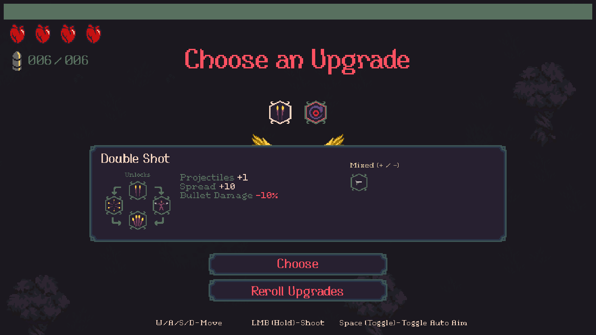

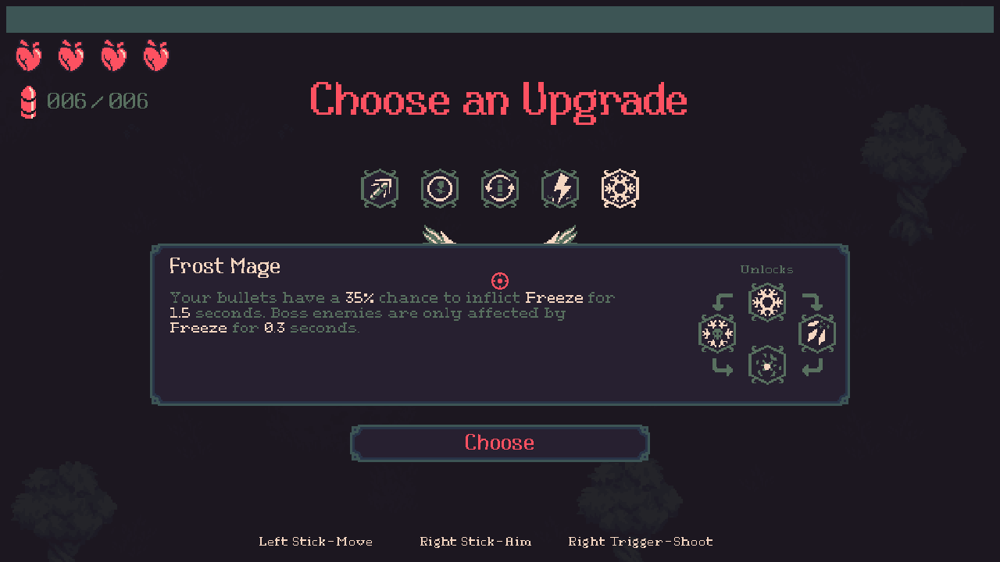

*Actual Windows controller selection capture. All25 regular native paths are checked; chart previews cannot select an unoffered upgrade. [Playtest fixes and projectile-color audit](docs/PLAYTEST-FIXES.md).*

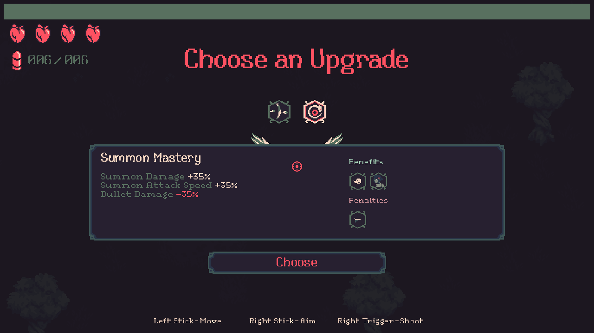

*Controlled native offers and actual controller selection. Summon damage helps Ghost Friend and Lilith’s spirits; summon attack speed is only attributed to consumers that use it.*

### Explore for optional rewards

Mint chests appear every **60–90 combat seconds**, with at most **three uncollected exploration chests**. Common rewards can appear together in different directions; the strongest upgrades are rarer. Rewards include XP, credits, healing, magnet, freeze, frenzy and eligible native upgrades.

Open-map placement varies across **5–30 seconds of walking**, with viewport and wall limits. Credit chests give **1,000 credits**; XP chests give **30% of the current level's full requirement**, including earned XP bonuses. The marker number shows **distance in game units**. Boss chests retain gold markers, independent of the three-chest cap. Fixed reward types, positions and timers survive Continue; credits use the normal payout.

*Actual native Windows spawn with controlled random/clock operands. The wider48-seed placement sample ranges from5.1–29.85 seconds of walking. Not the deliberate all-east marker overlap fixture. [Reward weights and rules](docs/EXPLORATION.md).*

### Finish a run with the controller

Victory and death show scores, the character/weapon loadout and **Try Again / Quit To Menu**, without the redundant skill list. Results navigation stays on those two buttons. Shown menus own controller focus, including recovery on the first controller input after switching from the mouse; no frame-by-frame focus override.

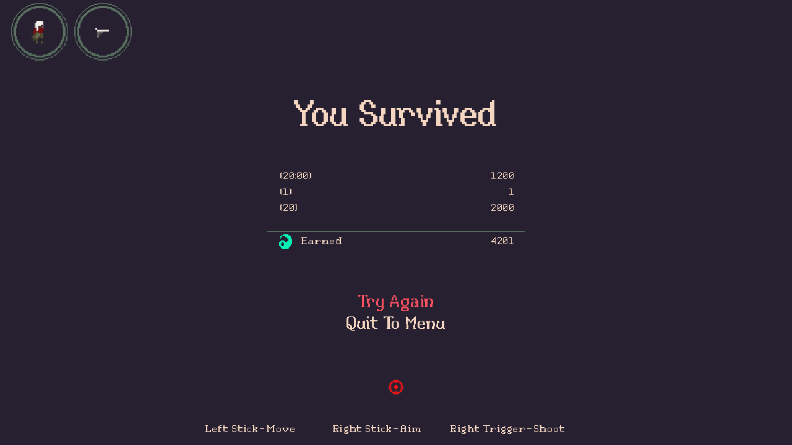

*Windowless Windows test with an actual Forest boss defeat, controlled combat clock, native victory, controller Retry, death and Quit. The test profile's score is not a natural full-run balance result.*

### Track clears at the selected difficulty

Locked modes use the native padlock and a concise unlock condition. Applicable mode buttons show a crown and recorded clear count **inside the button**, for the selected Darkness or Challenge tier. Quickplay uses its fixed difficulty; Endless and Custom have no completion crown. Historical per-mode win totals were never stored, so these counters begin with1.1.7.

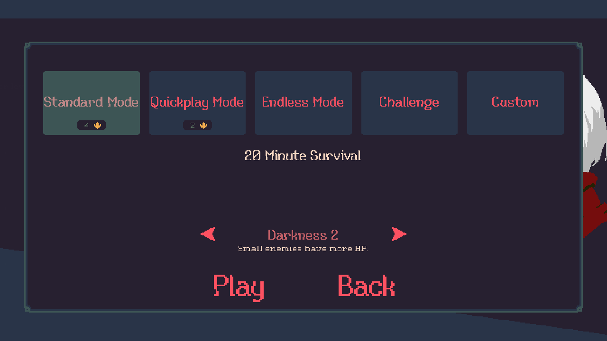

### Use the native Options menu with a controller

Metrics, visual style and **Zoom out** are native menu rows in title and pause Options. Zoom cycles0/25/50/75/100% extra world view without enlarging the HUD. Resolution remains usable in fullscreen; selecting a native16:9 resolution keeps that choice across re-entry/restart. The opaque background covers the previous menu and controller focus stays inside the panel.

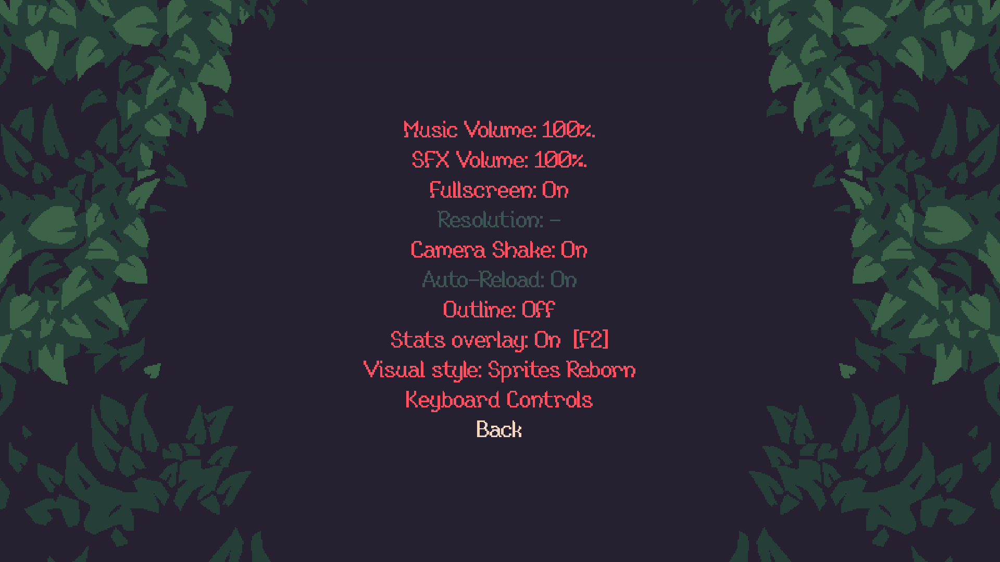

*Actual1080p Windows controller test with integrated settings and no F2 suffix on the Metrics row. Fullscreen request semantics are tested without switching the desktop display. [Controller UI corrections and evidence](docs/CONTROLLER-UI.md).*

### Unlock content through play

Characters, weapons and scenarios use thematic milestones instead of currency purchases. Conditions combine minibosses or bosses with Darkness, scenario and build requirements. For example, Diamond requires a Forest miniboss defeat while holding at least seven maximum red hearts. Existing ownership is preserved; earned unlocks generate queued notifications.

Browsing shows a natural unlock sentence. Confirm/click a locked character or weapon to expand its recorded attempt details; moving to another entry or reopening the roster returns to the concise preview. Inspection preserves ownership and credits.

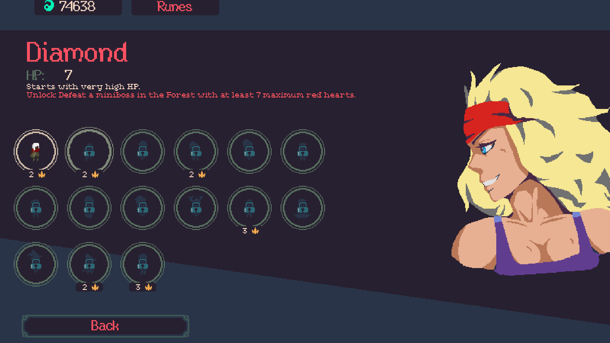

### Spend credits on runes

Each rank costs 20% more than the preceding rank, rounded upward. Enable multiple purchased runes in the same row. To buy a lower rune, fully upgrade the runes above it **in the same column**. The native five-rank cap remains.

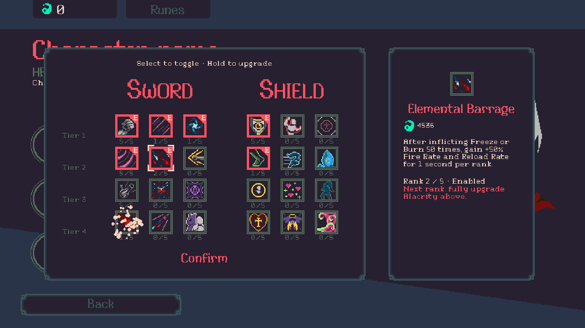

### Build a Custom run

Use the game's own menus to adjust the run, weapon, attributes, enemies, summons, upgrades and objects. **Load mode defaults** imports the selected mode's real settings. Only obtained content is available. Custom runs award **credits only**: no unlocks, achievements or leaderboard submissions.

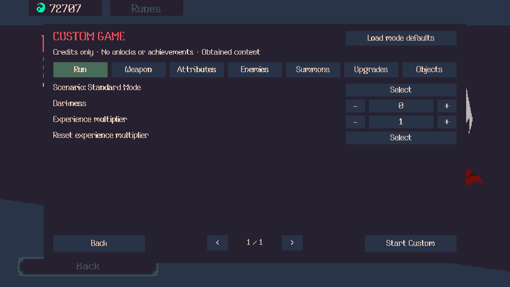

[Full Custom control inventory and save behavior](docs/CUSTOM.md).

## Install or upgrade

You need your own **Windows Steam build 12679152** (Unity 2019.4.40f1 Mono x64) and the supported **Android 8.6 / 1093 APKM**. Python 3.14 x64 and .NET 10 are the tested preparation prerequisites.

1. Download and extract the [v1.1.10 release ZIP](https://github.com/Darkaxt/20-Minutes-Till-Dawn-Revamped/releases/tag/v1.1.10).
2. Close the game and follow [INSTALL.md](INSTALL.md), including its upgrade instructions if Revamped is already installed.
3. Launch the game normally through Steam.

The release contains the mod and installer recipes. It prepares the required artwork/data locally from your owned inputs; extracted game assets and validation assemblies are not bundled. Installation preserves the original game files, saves and configuration and supports exact owned-file rollback.

**DroidDeck:** the Android updater finds the existing Steam game and installs compatible releases while preserving progress/settings. This runs the Windows mod inside DroidDeck. [Phone delivery and launch notes](docs/DROIDDECK.md).

### Update directly on Android

Install **Revamped Updater**, connect DroidDeck once through Android Files, then check and install compatible GitHub releases. It finds the game through Steam's library catalogue and remembers the folder; no custom folder, Linux browsing, root, Shizuku or GitHub login is needed.

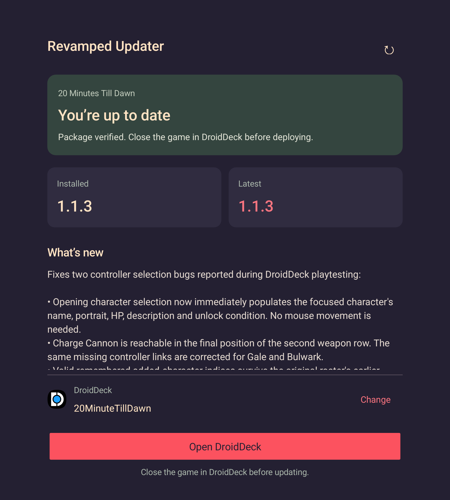

*Actual native Android view capture. The updater verified the real GitHub package and upgraded the tested phone from1.1.2 to1.1.3. Existing artwork and loader files must already match the release; incompatible changes report that Windows preparation is required before writing. [Updater instructions and limits](android-updater/README.md).*

## Controls

| Action | Control / location |
|---|---|
| Move, aim, shoot and character skill | Native keyboard/mouse/controller bindings |
| Toggle auto-targeting | Space; native controller equivalent |
| Off / Little / Extended metrics | F2 or Options; skills stay visible |
| Widen the world view | Options → Zoom out |
| Collected skill paths | Automatic rows; all acquired icons stay visible |
| Suspend a run | Pause → Save & return; Continue resumes it |
| Configure a Custom run | Custom selection; live settings from Pause |
| Optional recolours | Options; original artwork is the default |

The HUD groups acquired icons by native upgrade path, with a subtle glow for tripled skills and no tier/count text. Native auto-targeting remains available; no separate autofire toggle was added. Continue reconstructs the supported build and runtime state; it is not a frozen snapshot of every live enemy, projectile or RNG state.

## Changelog

### v1.1.10 — Phoenix facing

**Fixed:** Scarlett’s phoenix and other projectiles publish their visible angle immediately, including pooled reuse, instead of waiting for a physics update. **Checked:** all 37 loaded projectile templates in eight directions/two activations, independent spirit/icicle facing, both artwork modes, actual phoenix/Fire Starter contacts and Yuki animation after scene restart. Authored particles, artwork and combat recipes are preserved. [Release notes](release/NOTES-1.1.10.md).

### v1.1.9 — Results focus and useful exploration rewards

**Fixed:** results controller navigation/focus and duplicated benefit/penalty icons; mixed trade-offs now show once. **Improved:** removed the end-of-run skill list; exploration travel varies across5–30 seconds; credit chests give1,000 credits and XP scales with30% of the current level requirement, including native bonuses. Existing positions and collected totals survive Continue. **Ported:** no additional Android behavior; these are requested Revamped playtest corrections. [Release notes](release/NOTES-1.1.9.md) · [Reward rules](docs/EXPLORATION.md).

### v1.1.8 — Exploration chests and shared pointers

**Added:** weighted benign exploration rewards, simultaneous common chests in different directions, a three-chest cap and20–30-second walking targets on open maps. Native upgrade menus and credit payout, exact reward/timer/position persistence and Custom ownership rules are retained. **Fixed:** complete edge-marker bounds, same-direction separation and collected boss-pointer cleanup. **Ported:** no new Android behavior; exploration is a requested Revamped addition. [Release notes](release/NOTES-1.1.8.md) · [Reward rules](docs/EXPLORATION.md).

### v1.1.7 — Stillness correction and compact native menus

**Fixed:** Stillness blocks movement only while shooting; releasing fire and reloading restore movement, including existing checkpoints. Its bonuses are retained. **Improved:** twelve metric rows without duplicate hearts/magazine; hexagon-framed Benefits/Penalties icons and character portraits; native campaign padlocks, concise descriptions and no shortcut suffix on the Metrics setting. **Added:** recorded clear-count crowns inside applicable mode buttons, separated by selected Darkness/Challenge tier. Historical totals are not invented. [Release notes](release/NOTES-1.1.7.md) · [Contracts and evidence](docs/PLAYTEST-FIXES.md).

### v1.1.6 — Playtest fixes and cleaner build HUD

**Added:** acquired-path HUD rows, current-build summon/Synergy help and off-screen chest directions. **Fixed:** hidden native upgrade charts, zoomed damage-number readability, square-screen HUD placement, reload benefit colors and neutral Shotgun/fireball rendering in Sprites Reborn. **Improved:** icon-only skills with triple-acquisition glow and benefit-first Glass/Stillness descriptions, preserving their actual gameplay trade-offs. [Release notes](release/NOTES-1.1.6.md) · [Contracts and color audit](docs/PLAYTEST-FIXES.md).

### v1.1.5 — Display, readable unlocks and Isaac-style HUD

**Added:** persistent native Zoom out; Off/Little/Extended metrics with pastel value comparisons; centered timer and current-run credits. **Fixed:** fullscreen Resolution selection/persistence and skill-column clipping at4:3. **Improved:** character/summon/weapon metric ordering, natural unlock sentences and attempt details on locked-entry activation. Native skills/counts/tiers, Continue, controller/pointer navigation and Challenge spacing are preserved. [Release notes](release/NOTES-1.1.5.md).

### v1.1.4 — Controller menus and native Options

**Fixed:** controller access to Challenge/Custom and their native tier/Play/Back flow; Custom numeric-field focus traps; B/Cancel on failed Continue. **Improved:** stats HUD and visual style are native Options rows in title and pause, with an opaque background and navigation confined to the panel. Pointer input, settings persistence, existing locks, credits and saved checkpoints are preserved.

Verified with Unity controller/pointer events at720p/1080p, all Custom tabs/pages, rune traversal, roster regression and fresh-process settings. [Release notes](release/NOTES-1.1.4.md) · [Controller ledger](docs/CONTROLLER-UI.md).

### Android updater 0.1.0

**Added:** automatic DroidDeck Steam-library detection after one folder grant, remembered installation, public GitHub release notes/download verification, compatible code deployment, installed-file read-back and interrupted-update recovery. Native Android UI follows the selected utility layout with Revamped colors. This is a separate APK; the game was1.1.3 when this client was released.

### v1.1.3 — Controller roster fixes

- Character name, portrait, HP and description initialize immediately on controller entry, including remembered selections and re-entry.
- Charge Cannon is reachable at the end of the second weapon row. Gale and Bulwark also have complete native controller links.
- Locked content remains previewable without being playable or spending credits. Valid remembered added characters are restored after the original roster initializes.

Verified with actual controller and mouse input in the isolated Windows player at 1280×720 and 1920×1080. Saves, ownership and gameplay balance are unchanged. [Release notes](release/NOTES-1.1.3.md).

### v1.1.2 — Android integration closure

**Ported:** complete Abby spray/final-shot and base/charged shooter flow; global Spark/Dragon Bond observers and target selection; source reload activation/audio, hit/burn/pickup filters, 0.03-second physics cadence and gameplay transition ownership. The retained-code and acquisition comparison is closed, with explicit dispositions for source quirks.

**Fixed:** Glass is rebuilt from acquisitions at run boundaries, preventing repeated warm Continue from multiplying its bonus. Working Hina, Holy Shield and Gun Glyph contacts are retained under the approved collision-defect corrections.

[Release notes](release/NOTES-1.1.2.md) · [Detailed parity ledger](docs/PARITY.md).

### v1.1.1 — Character, enemy and description fixes

**Fixed:** Hina's first detached Shadow Clone keeps its skill-origin position; Rhogog's reused explosion rearms its existing damage child; destroyed Thousand Blades helpers unsubscribe. Thunderspawns, Soul Knight, Cadence, Tenacity and Reckless descriptions now match their mechanics.

### v1.1.0 — Remaining ports and the anomaly correction batch

**Ported:** complete Crossbow-family auto-release, laser arming/rearming, Yog/Reaper spawn cues, source camera following and Blessing cooldown ownership.

**Fixed:** Smite kill reporting; frozen-only Shatter; Elemental Barrage contributions; Might and positional-lightning damage signs; exact pool caps and renderer reuse; finite reward-offer exhaustion; Specialize lifetime; Bulwark/Gale run resets; arena-edge reuse; late Darkness damage; Pulsing Summons configuration; temporary-buff and legacy Continue reconstruction; Growth reward duplication; LargeXP renderer binding; burn reuse/invalid targets; Fire Edge teardown; Soul Powered contribution leaks; and Hidden Blade knockback contacts. The reviewed ownership-inversion branch has no Windows equivalent to repair.

### Initial Revamped additions retained in v1.1.2

**Added:** transparent Isaac-inspired icon HUD; thirty milestone unlocks and persistent notifications; same-column rune progression, 20% rank pricing and multiple enabled row choices; Save & return / Continue; native Custom menus, owned-content limits, credits-only results and mode-default loading; reversible Sprites Reborn recolours with palette extensions; pixel-art maintenance credit; removal of the Emberpath promotion.

**Ported:** Charge Cannon and all three evolutions; Gale and Bulwark with their exclusive upgrades; existing character, summon, projectile/status, stat, perk/rune and scenario/mode behavior from Android 8.6. Later releases above complete and correct this integration rather than redefining its scope.

[Full anomaly history](docs/ANOMALIES.md) · [Correction-by-correction evidence](docs/BUGFIXES.md) · [Release and verification history](docs/PROGRESS.md).

## Verification and limits

The **1.1.10** source passes the directional-effects audit documented in [PROGRESS.md](docs/PROGRESS.md); current copied-package and public-download gates are tracked there. The previous published **1.1.9** package passes native results navigation, Retry/death/Quit, complete retained menus, Mixed relations, varied exploration placement, scaled XP/credits, current/older Continue and native payout. Copied installation/rollback and the independently downloaded public package are verified in [PROGRESS.md](docs/PROGRESS.md). The unchanged gameplay integration retains its recorded acquisition, fire/reload, contact, lifecycle, restart, legacy and Custom checks. The Android updater previously completed a real1.1.2→1.1.3 update; current compatible releases remain user-deployed. [Controller verification](docs/CONTROLLER-UI.md).

These are bounded source and gameplay checks, not a natural full-run balance study or a test of every character × weapon × upgrade combination. The next step is user playtesting before broader promotion. [Exact delivery receipt](docs/PROGRESS.md).

The gameplay images above are unaltered Windows test screenshots, including earlier UI runs whose behavior remains in the release. They show test builds rather than claiming natural unlocks or full-run balance. The updater image is explicitly labelled as a native Android capture. [Screenshot provenance](docs/images/SOURCES.md).

## Development and credits

This is an independent mod repository; the proprietary game has no public source repository to fork. Game binaries, extracted artwork, saves and raw disassembly are not published here. [Development and migration notes](docs/MIGRATION.md) · [Redirected-code audit](docs/DEAD-CODE.md).

For an already prepared development player, set `MODERNIZATION_SCRATCH` to a root containing `game/MinutesTillDawn_Data/Managed` and `game/BepInEx/core`. Build the production project or the separate `validation/Validation.csproj` with the documented SDK; keep the validation assembly out of a normal installation. [Build instructions](INSTALL.md#build-from-source).

**Flanne** created the original game. **Darkaxt** maintains Revamped. Original repository code is MIT licensed; game assets and dependencies retain their owners' rights and licenses. Third-party mod binaries are not bundled. [Third-party notices and artwork credits](docs/THIRD-PARTY.md).
