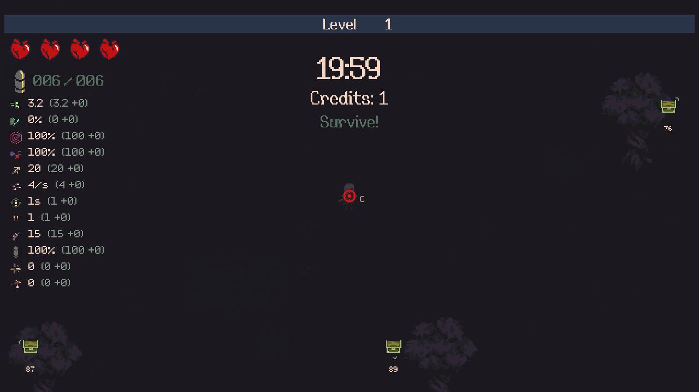

# Exploration chests

## Paced magnet and orb marker — 2026-10-29

[Current authoritative follow-up](ELEMENTS.md#local-fire-panic--2026-10-29), F05–F06: the chest magnet now starts attraction as a wave at12 world units per combat second. The normal0.3-second flight follows each orb's delay. Equal-distance clusters start at least1/60 second apart per magnet reward, keeping a dense ring from collecting on one frame. Nearby ordinary pickup may claim a waiting orb sooner; an orb already in flight is not restarted by another chest. Pause freezes the wave and pool return clears it. All original XP and pickup callbacks remain intact; no new ground-orb persistence is introduced.

XP rewards now use a three-orb pixel cluster, shaded in the native pickup tint, rather than the cross-shaped SmallXP sprite. This supersedes I01's original XP-icon choice below. Actual ground XP, healing/soul-heart art and reward amounts are unchanged. The same cluster represents full-health/exhausted-upgrade XP conversions and old credit rewards. The battle owner releases its generated sprite/texture on exit.

## Reward icon correction — 2026-10-29

Authoritative follow-up, already authorized by the request to audit reward icons and reuse native heart/soul-heart pickups:

- I01: Audit all seven exploration reward types and their native icon sources. Use the existing XP pickup for XP and the existing red-heart pickup for red-heart healing, replacing the Vitality maximum-health upgrade icon. Inspect soul-heart pickup artwork and keep it reserved for effects that actually award soul hearts; this pass adds no new reward type. Exact normal/character upgrades retain their own upgrade icons. For utility effects, reuse an equivalent native pickup when one exists; otherwise document the existing symbol and the effect it represents.
- I02: Edge icons, arrow color and nearby chest glow must match the reward currently available at collection. A full-health healing chest and a no-longer-eligible fixed upgrade show XP. Health changes and acquiring upgrades update the preview without rerolling or rewriting the saved primary reward. Preserve boss chest icons and native pickup/gameplay behavior, weights, amounts, health capacity, XP multipliers and save compatibility.
- I03: Verify the complete preview/collection flow in the real Windows player: damaged/full-health transitions, exact heart versus soul-heart artwork, XP conversion and its amount, fixed-upgrade exhaustion, both visual styles, representative viewports/zoom and current/prior Continue. Verify the final package, copied install/rollback and independent public download. Publish normal v1.3.3 through the existing channel, retain updater0.2.0/save-epoch1, update the README/audit ledger and clean task scratch. Live Steam/profile/phone installations remain untouched.

| Stage | Status | Acceptance |
|---|---|---|
| I1 Reward presentation | COMPLETE | I01–I02 and source/runtime I03 pass native3,5,6,7: exact heart/soul/XP artwork and tint, all seven rewards, full/damaged and exhausted-upgrade previews, original collection amounts/max HP, both styles/viewports/zoom, current/prior Continue and boss separation. I1-acceptance.json binds the sources. No blocker or deferral. |
| I2 Rune reward presentation and Score labels | COMPLETE | Native10/14/16/17/18/20 verify fanfare/descriptions, real accepted/declined effects, duplicate/active/capped rules, held input, controller/pointer, current/public1.3.1 Continue, Score/results and explicitly enabled Endless starting runes. I2-acceptance.json binds the source. No blocker or deferral. |
| I3 Final delivery | COMPLETE | Normal public1.3.3 frombcb7276; exact packaged icons, dynamic previews, actual rune effects/decisions, Standard/Endless, current/public1.3.1 Continue, Score/results and controller menus pass. Copied install/rollback, independent public source/hash read-back and reviewed cleanup pass. Updater0.2.0/epoch1 retained; live Steam/profile/phone untouched. |

Storage: `D:/Temp/20mtd-reward-icons-20261029` is the exact .NET/native small-file I/O exception. Retained required evidence and deliverables use `D:/Projects/20MTD-Modernization-evidence/reward-icons-20261029`. Existing shared inputs retain their paths.

Mint-tinted chests appear beyond the visible playfield on reachable ground. They are separate from gold boss chests and have no ambush or penalty mechanic. A run can have **at most three uncollected exploration chests**; boss rewards keep their existing lifecycle.

**Uncollected exploration chests do not expire.** They remain until collected or the run ends, including across cell changes. Save & return / Continue preserves their fixed positions and rewards.

In1.3.4 the edge content indicator remains visible until the **whole chest artwork** is inside the camera viewport and clear of the native HUD, metrics and skill icons. The earlier center-only handoff could hide the pointer while the skills HUD covered the chest. This presentation correction does not remove/claim the chest or change its rewards. [Render/contact regression](VISUALS.md).

## Honeycomb layout — 1.3.10

[Authoritative rules and acceptance](POI-HONEYCOMB.md). Timed waves and the old total population cap are replaced by fixed, shared honeycomb vertices. Side length is36 world units. Only current-cell chests are physical; the radar shows the three nearest uncollected exploration vertices, including nearby cells. A seeded arrangement gives each unobstructed six-vertex cell one XP, one healing, one magnet, one freeze, one frenzy and one upgrade opportunity. A vertex-specific10% lottery replaces the upgrade with a character upgrade. Terrain exclusions omit vertices rather than adding higher-value replacements.

The run saves its seed, origin, discovered contents and collected vertex identities. Backtracking and Continue do not regenerate rewards. Old optional-field checkpoints retain their previous unclaimed positions/contents, earned Score and frenzy, then adopt the grid without a reset. There is no exploration spawn clock.

Reward amounts remain:30% of a full level's XP requirement; one red heart; paced magnet;3-second freeze; +25% bullet/summon damage and fire rate for15 combat seconds; or a native eligible upgrade. Exploration gives no currency. A full-health healing reward or an exhausted stored upgrade previews/grants its normal XP replacement.

Permanent upgrade rewards respect current prerequisites and remaining repetitions. Their exact upgrade is chosen when the vertex is first discovered. If it has become unavailable before collection, the chest grants the percentage XP reward rather than rerolling or opening an empty menu. XP is calculated when collected from the current full level requirement, not the remaining XP gap. Native XP multipliers still apply. There is no content-unlock bypass. Custom retains its obtained-content and no-achievement rules.

## Shared pointers

Boss and exploration chests use the same marker layout: a content icon, directional arrow and rounded distance in game world units. Exploration uses the native XP pickup with its green tint, the native red-heart pickup for healing, utility symbols or the exact eligible upgrade artwork. Its arrow uses the reward color. Boss treasure retains its native chest icon. Markers disappear when their targets are visible, collected or removed, and separate when several targets share a direction. The layout accounts for the safe area and existing HUD graphics.

### Native icon audit

| Reward or source | Artwork used | Meaning |
|---|---|---|
| XP and XP replacements | `PF_SmallXPPickup/Bounce`, `T_SmallCircle`, with its native green renderer tint | Existing percentage XP reward |
| Red-heart healing | `PF_HeartPickup/Bounce`, `T_HeartPickup` | Restore one missing red heart; replaces the misleading `Icon_Vitality` skill icon |
| Soul-heart pickup | Native `SHPPickup`, `PF_SoulHeartPickup/Bounce`, `T_SoulHeartPickup` | Audited separately; reserved for soul-heart effects. Exploration currently grants no soul-heart reward |
| Magnet | Existing `Icon_Magnetism` | Collect existing ground XP; the symbol represents the utility effect |
| Freeze | Existing `Icon_IceMagic` from Frost Mage | Temporary enemy freeze |
| Frenzy | Existing `Icon_RapidFire` | Temporary damage/fire-rate boost |
| Normal / character upgrade | Exact selected powerup's own icon | The actual eligible permanent upgrade for this run |
| Boss treasure | Native `Chest_0` | Existing boss reward chest |

Native Windows pickup inventory distinguishes healing hearts, soul hearts, XP, boss treasure, devil deals and Halo pickups. The utility effects reuse existing effect symbols rather than substituting unrelated health or upgrade artwork.

The preview follows the reward available now: healing shows XP at full red health and returns to the heart if red health is lost. A fixed upgrade that has become unavailable shows XP. The icon, arrow and nearby glow update together. The saved primary reward and selected upgrade remain unchanged; these previews neither reroll nor collect the chest. The collection notice says **Healed 1 heart**, avoiding an implication of additional maximum health.

World exploration chests retain the normal chest's red/blue fog-reveal sprites, so their artwork is visible through the shadows when the edge pointer hides. These mask colors are internal lighting channels and are independent of the content colors below.

### Nearby content colors

A small, steady glow fades in within **eight world units**, reaching full strength within **two**. Distant world chests remain mint; their edge icons show the currently available reward. The glow uses the game's existing circle artwork and visible-in-fog rendering, with no pulse, panel or new setting. It works with Original and Sprites Reborn.

| Primary content | Nearby glow |
|---|---|
| Experience | Mint / teal |
| Healing | Rose |
| Magnet | Violet |
| Freeze | Ice blue |
| Frenzy | Orange |
| Normal upgrade | Lime |
| Character upgrade | Pink |

Color indicates the currently available reward, including full-health or exhausted-upgrade XP replacements. The stored roll, collection amounts, health capacity and native XP multipliers are preserved. Boss chests retain their original artwork and lighting.

This is a controlled native Windows spawn in different directions, with distances45,71 and76 game units. A48-seed real-geometry sample includes journeys from5.1 to29.85 seconds at the fixture's walking speed. These are placement checks, not natural full-run balance evidence. It is distinct from the deliberate all-east overlap stress test.

## Continue and credits

The existing checkpoint stores chest positions, fixed reward types/upgrades, the separate exploration random sequence, spawn time remaining, frenzy time remaining and previously earned exploration credits. Continue restores those values without another reward roll or another frenzy stack. Already-saved unopened credit chests become XP chests before their world objects and pointers appear; their positions and random sequence stay unchanged. Checkpoints predating exploration initialize an empty exploration state.

Previously collected exploration credits remain in the run's normal total and reach the wallet through the existing end-of-run payout. No new exploration credits are added. Native boss rewards and ordinary end-of-run credit calculations are unchanged.

Runtime and delivery evidence is recorded in [PROGRESS.md](PROGRESS.md). Tests use isolated Windows profiles, controlled clock/random operands and synthetic controller/pointer devices. They do not establish natural full-run balance or phone presentation.
